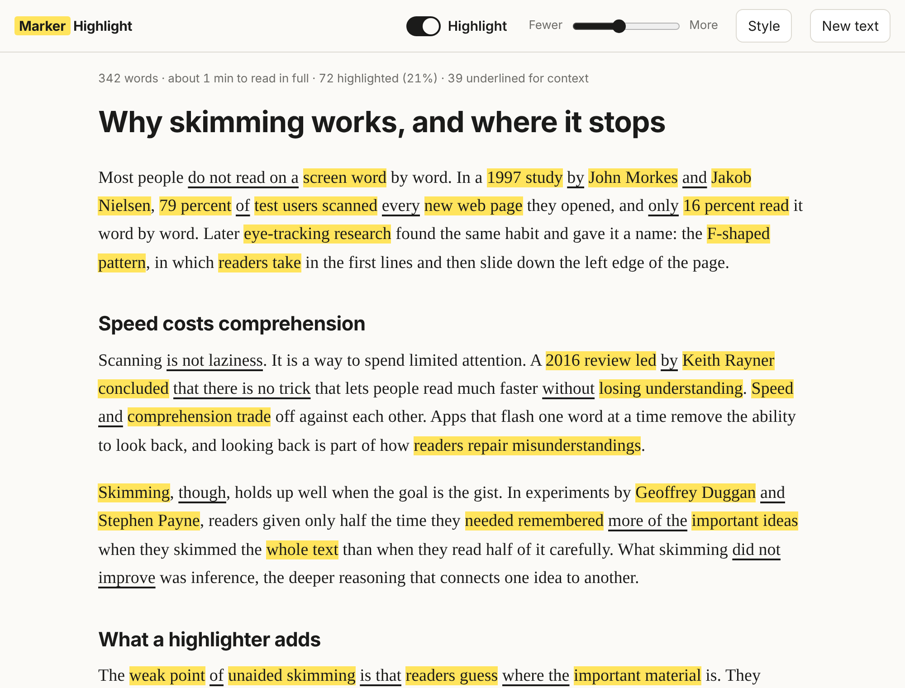

# Marker Highlight

Highlights only the most important words in a text, so you can skim it quickly without
leaving the original for a summary. Your text is analysed on your device and never uploaded.

**[Try the live demo](https://rasika-deodhar.github.io/marker-highlight/)** — nothing to install.



It starts as a small web app and is built so the same engine can run as a browser
extension later, behind a toggle that reads a page only when you ask it to.

## Run it

The quickest way is the [live demo](https://rasika-deodhar.github.io/marker-highlight/). To run it locally:

Requires Node 20+ (only to serve the files; there are no dependencies to install).

```bash
npm start
```

Then open http://localhost:5173. Any static file server works too.

```bash
npm test
```

## Use it

- **New text**: paste text, or open a file. You can also drop a file anywhere on the page.
  In pasted text, lines starting with `#` become headings.
- **Supported files**: PDF, EPUB, Word (`.docx`), Markdown, HTML and plain text. Files are read
  in your browser and never uploaded. A PDF is shown as reflowed text, not as its original
  pages, so it reads the same as everything else. Scanned PDFs (images of pages) have no
  text to read and need OCR first. Copy-protected (DRM) EPUBs cannot be opened.
- **Highlight** switch (or `H`): turn highlights on and off.
- **Fewer / More** (or `[` and `]`): how much is highlighted, from 5% to 40%.
- **Style**: marker or underline, colour, "underline context words" and "dim everything else".
- **Light/dark**: the moon/sun button in the toolbar switches theme. "Match system" is in
  the Style menu. Your choice is remembered.
- **Listen**: reads the text aloud and marks the sentence being spoken so you can follow it.
  - *Everything* reads the full text. *Highlights only (quick read)* reads just the
    highlighted and underlined words, the way your eye skims, so you hear the gist.
  - Speed goes from 0.5× to 3×, and you can pick the voice and step back or forward a
    sentence. Playback starts from what is on screen.
  - Voices come from your browser. Ones marked "online" send the spoken text to the
    browser's vendor; on-device voices are chosen by default.
- **Dictionary**: turn it on, then click a word (or select a short phrase) to see a brief
  meaning in a card above it, with a link to its Wikipedia article. Press Escape or click
  elsewhere to carry on reading.

## Privacy

Your text is analysed, and files are read, inside your browser tab. Nothing is uploaded or
stored, with two exceptions that you control:

- **Dictionary** (off by default): looking up a word sends that one word, not your text,
  to Wiktionary and Wikipedia.
- **Listen** with a voice marked "online": the browser sends the text it speaks to its
  vendor's speech service. On-device voices do not.

There are two kinds of mark. **Marker** is for the important words themselves. A thinner
**underline** is for words that are not keywords but that the meaning depends on: "not",
"never", "only", "but", "unless", and the small words between highlights.

Use the highlights as a first pass to find what deserves a full read. Skimming keeps the
main ideas but not the reasoning between them.

## How it works

```
app/        UI shell (controls, preferences, text input)
src/dom/    reads text out of any DOM subtree, paints with the CSS Custom Highlight API
src/core/   the engine: text in, character ranges out; no DOM, no network
eval/       annotated texts and the evaluation runner
tests/      engine, context-tier and evaluation tests
```

The engine scores each word by frequency, spread, capitalisation, heading membership and
position, then selects a small share as whole phrases and guarantees every paragraph one
highlight. A second pass underlines every negation with the phrase it negates, plus
contrasts, qualifiers and in-between words. Painting does not modify the page's DOM.

`npm run eval` scores the engine on annotated texts and audits that no mark drops a
meaning-changing word. Current result at the default amount: 79% of key words fully
highlighted, 93% of meaning-critical phrases marked, zero audit findings.

## Documentation

- [Research and UX rationale](docs/RESEARCH.md): what reading research says and the design decision each finding led to, with sources.
- [System design and architecture](docs/ARCHITECTURE.md): layers, data flow, scoring model, extension mapping, decisions and limitations.
- [Evaluation](docs/EVALUATION.md): how coverage and meaning preservation are checked, current numbers, and what the checks cannot show.
- [Roadmap](docs/ROADMAP.md): phases from this app to a measured, multi-browser extension.

## Browser support

Chrome/Edge 105+, Safari 17.2+, Firefox 140+ (needs the CSS Custom Highlight API).
