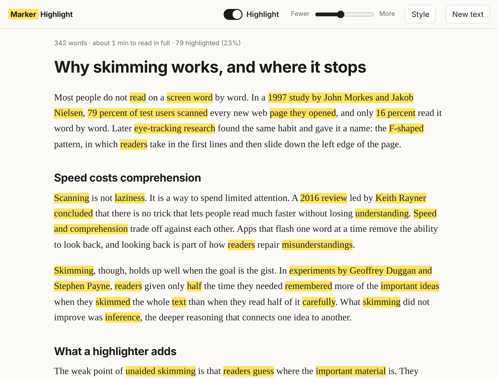

# Marker Highlight

Highlights only the most important words in a text, so you can skim it quickly without
leaving the original for a summary. Everything runs on your device.



It starts as a small web app and is built so the same engine can run as a browser
extension later, behind a toggle that reads a page only when you ask it to.

## Run it

Requires Node 20+ (only to serve the files; there are no dependencies to install).

```bash
npm start
```

Then open http://localhost:5173. Any static file server works too.

```bash
npm test
```

## Use it

- **New text**: paste text or open a `.txt`/`.md` file. Lines starting with `#` become headings.
- **Highlight** switch (or `H`): turn highlights on and off.
- **Fewer / More** (or `[` and `]`): how much is highlighted, from 5% to 40%.
- **Style**: marker or underline, colour, and "dim everything else".

Use the highlights as a first pass to find what deserves a full read. Skimming keeps the
main ideas but not the reasoning between them.

## How it works

```
app/        UI shell (controls, preferences, text input)
src/dom/    reads text out of any DOM subtree, paints with the CSS Custom Highlight API
src/core/   the engine: text in, character ranges out; no DOM, no network
tests/      engine unit tests
```

The engine scores each word by frequency, spread, capitalisation, heading membership and
position, then selects a small share, guarantees every paragraph one highlight, and merges
neighbours into phrases. Painting does not modify the page's DOM.

## Documentation

- [Research and UX rationale](docs/RESEARCH.md): what reading research says and the design decision each finding led to, with sources.
- [System design and architecture](docs/ARCHITECTURE.md): layers, data flow, scoring model, extension mapping, decisions and limitations.
- [Roadmap](docs/ROADMAP.md): phases from this app to a measured, multi-browser extension.

## Browser support

Chrome/Edge 105+, Safari 17.2+, Firefox 140+ (needs the CSS Custom Highlight API).
