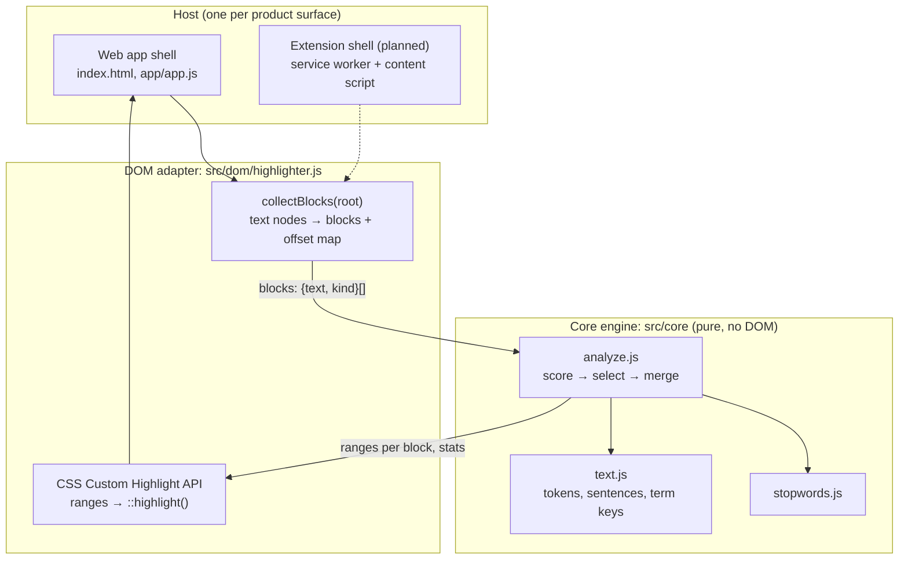

# System design and architecture

## Goals and constraints

- **Lightweight.** No framework, no dependencies, no build step. About 500 lines of source.
- **Private.** Text is analysed where it is displayed. Nothing is sent or stored.
- **Extension-ready.** The app is the first host; a browser extension is the second. Moving
  to the extension must not require rewriting the engine or the painting code.
- **Reversible.** Turning highlights off restores the page exactly.

## Layers



| Layer | Files | Knows about | Does not know about |
|---|---|---|---|
| Core engine | `src/core/*` | Strings, offsets | DOM, browser, UI, storage |
| DOM adapter | `src/dom/highlighter.js` | Any DOM subtree, the Highlight API | Where the DOM came from, UI state |
| Host shell | `app/*`, `index.html` | Controls, preferences, text input | How importance is computed |

The dependency direction is strictly downward. The contract between adapter and core is
one function:

```js
analyze(blocks: ({ text, kind?: 'body' | 'heading' } | string)[], { density, stopwords, commonWords })
  → { blocks: { ranges: [start, end][] }[], stats: { words, highlighted, density }, keywords }
```

Ranges are character offsets into each block's `text`. Anything that can produce blocks
and consume ranges can host the engine: a web page, a PDF text layer, an e-reader, a CLI.

## Data flow for one toggle

1. The user turns the switch on (or changes the amount).
2. `collectBlocks(root)` walks the subtree with a `TreeWalker`. It rejects subtrees that
   are not prose (`script`, `code`, `pre`, form controls, `nav`, hidden and editable
   elements), groups consecutive text nodes under their nearest non-inline ancestor into a
   block, and records where each text node starts within the block's text.
3. `analyze(blocks, { density })` returns ranges.
4. Each range is mapped back to a DOM `Range` through the offset map (binary search) and
   added to one `Highlight` object registered as `CSS.highlights.set('marker-highlight', …)`.
5. CSS paints it: `::highlight(marker-highlight) { background-color: … }`.
6. Off: `CSS.highlights.delete('marker-highlight')`. The DOM was never modified.

## Scoring model

Single-document, unsupervised and deterministic, in the family of YAKE, RAKE and TextRank
(references 18–20 in [RESEARCH.md](RESEARCH.md)). It is a heuristic and its weights were
set by inspection, not trained.

**Term score** (one per distinct word, after folding case, plurals and possessives):

| Signal | Weight | Reasoning |
|---|---|---|
| Frequency, `log(1+tf)` normalised | 0.35 | Repeated terms are the topic |
| Spread across paragraphs | 0.15 | Topic terms recur throughout; incidental ones cluster |
| Mid-sentence capitalisation, acronyms | 0.20 | Names of people, places, things |
| Appears in a heading | 0.15 | The author's own importance signal |
| Word length | 0.12 | Longer words are rarer; a stand-in for corpus rarity |
| Early first mention | 0.03 | Key ideas are introduced first |

Adjustments: function words (stopwords) score zero. Everyday content words ("people",
"time", "way") are discounted by 0.55 as a substitute for corpus IDF. Numbers skip the
formula and get a fixed 0.55, because figures are dense facts however rarely they occur.

**Occurrence score** (one per word on the page) = term score, scaled by how important the
sentence is (sum of its term scores over the square root of its length), ×1.15 in a
paragraph's first sentence, and decayed for each earlier occurrence of the same term in
the paragraph (×0.6) and in the document (×0.85, floor 0.4).

**Selection.** The top `density × word count` occurrences are selected. Then every body
paragraph of 12+ words with nothing selected gets its best word. Then phrases are
completed: a number takes the word after it ("79 percent"), and one function word between
two selected words is absorbed ("speed and comprehension"). Adjacent selections merge into
one range. Phrase completion can push the final share a few points above the requested
density; the tests bound this.

Each of these rules traces to a finding in [RESEARCH.md](RESEARCH.md#from-findings-to-design).

## Mapping to a browser extension

| App today | Extension (Manifest V3) |
|---|---|
| `app/app.js` reads controls, calls the highlighter | Service worker handles the toolbar click and keyboard command; popup holds the same controls |
| Highlighter root = `#reader` | Root = the page's main content (`<article>`, `<main>`, else `document.body`) |
| Text comes from paste or file | Text is already in the page |
| CSS in `app/styles.css` | The `::highlight` rules injected with `scripting.insertCSS` |
| Preferences in `localStorage` | `chrome.storage.sync` |
| Modules loaded natively | Core + adapter bundled into one content script (content scripts cannot be ES modules) |

Permission model: `activeTab` + `scripting` only. The extension has no access to any page
until the user clicks its button or presses its shortcut, access covers that tab only, and
installing it shows no "read all your data" warning. This is the "toggle with permission"
behaviour the product needs. Remembering the setting per site would need optional host
permissions, requested at the moment the user asks for it.

## Decisions

**D1. Highlight in place; do not summarise.** Readers who dislike leaving the original
text for a summary are the audience. In-place marks keep context and allow re-reading,
which the research says matters. Consequence: the tool cannot shorten a text, only guide
the eye through it.

**D2. Statistical engine on the device; no language model, no server.** Instant, free to
run, works offline, deterministic, and nothing leaves the device. Cost: it has no real
understanding. It cannot tell a crucial "not" from a routine one and is weakest on short
texts, where frequency carries little signal. The `analyze()` contract is where a better
ranker can be swapped in later without touching the rest.

**D3. The core has no DOM access.** It is testable in Node in milliseconds and portable to
a worker or an extension. Cost: the adapter must maintain an offset map between block text
and text nodes.

**D4. Paint with the CSS Custom Highlight API, not wrapper elements.** Wrapping words in
`<mark>` or `<span>` changes the page's DOM, which can break a host page's scripts,
selectors and editors, and must be undone node by node. The Highlight API paints ranges
without touching the DOM, so "off" is one call. Costs: only a few properties can be styled
(colours, text decoration, shadow; not font weight), highlights are not announced by
screen readers, and it needs Chrome/Edge 105+, Safari 17.2+ or Firefox 140+. Older
browsers get a notice and a disabled switch. A `<mark>` fallback was not built.

**D5. No build step and no dependencies for the app.** The whole product is static files;
any static host serves it. A bundler arrives only with the extension, where it is required.

**D6. Density is bounded to 5–40%, default 20%.** Sparse marks are the mechanism. The
bounds are enforced in the engine, not only in the slider.

**D7. Headings are evidence, not targets.** Heading words raise term scores but headings
are not marked and do not count toward the word total.

**D8. User text is never persisted and never parsed as HTML.** Only display preferences go
to `localStorage`. Input is inserted with `textContent`, so pasted markup cannot execute.

**D9. Tokenisation uses a Unicode regular expression.** Works for scripts that separate
words with spaces. Chinese, Japanese and Thai need `Intl.Segmenter`, and every language
needs its own stopword list; both are roadmap items and both are injectable today.

**D10. Re-analyse on every change.** Analysis is linear in text length apart from one
sort, and takes milliseconds for article-length text, so there is no cache to invalidate.
Book-length input should move to a Web Worker.

## Known limitations

- English only in practice (D9).
- Sentence splitting and plural folding are simple rules and make occasional mistakes.
- Paragraphs with no distinctive terms receive only the single guaranteed highlight.
- The adapter decides what is a block from tag names, not computed styles. Pages that
  build paragraphs from styled `<span>`s will be read as one long block.
- The app accepts plain text and Markdown-style `#` headings only; no URL, HTML or PDF
  import yet.
- Effect on reading speed and comprehension is unmeasured.

## Testing

`npm test` runs the engine's unit tests in Node (tokenising, term folding, sentence
breaks, stopword exclusion, heading handling, density bounds, paragraph coverage, phrase
merging, range validity, determinism). The DOM adapter and UI were checked in headless
Chromium by hand-written script during development; automated browser tests are a roadmap
item.
